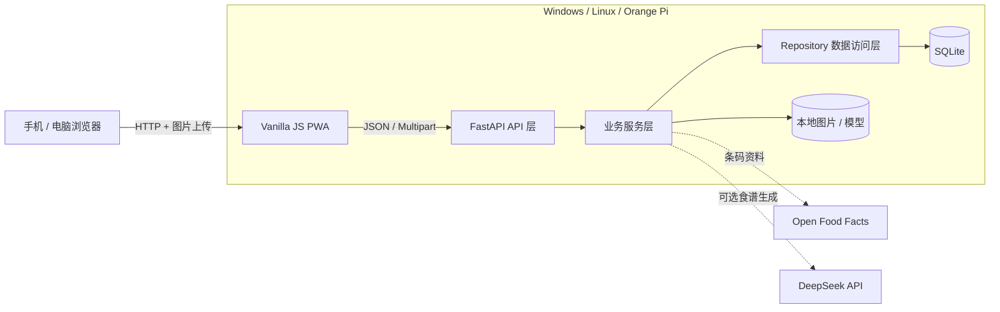
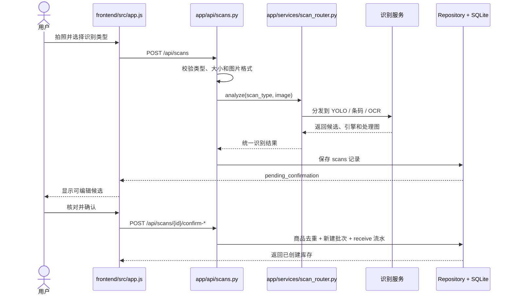
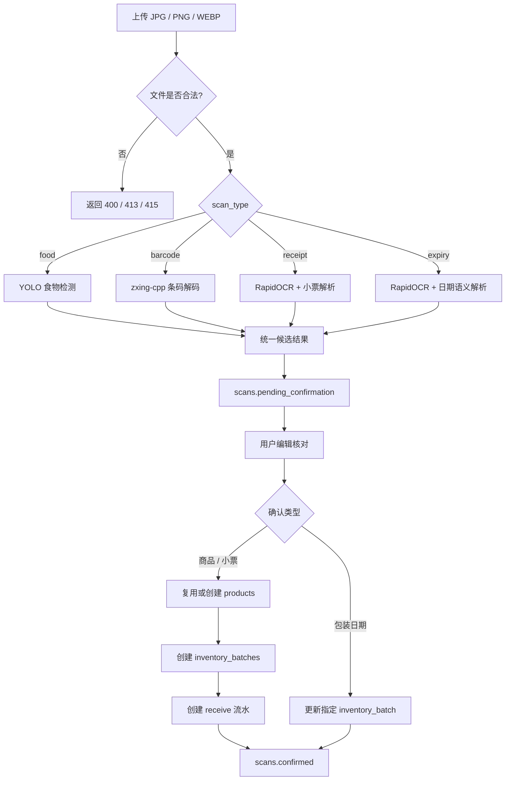
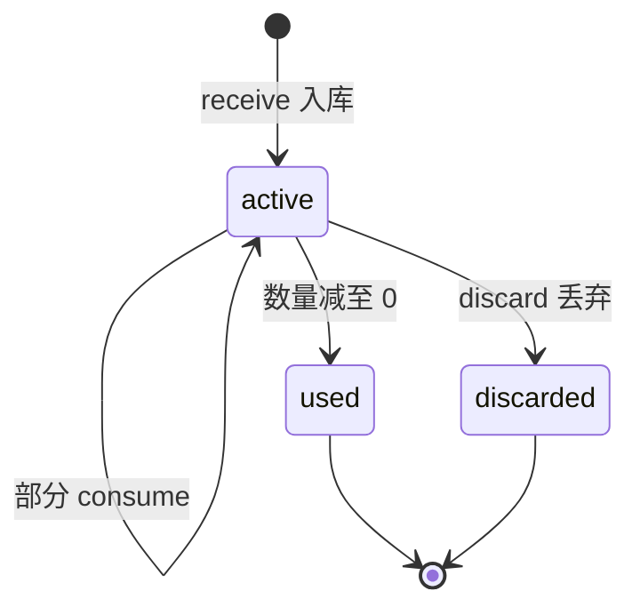
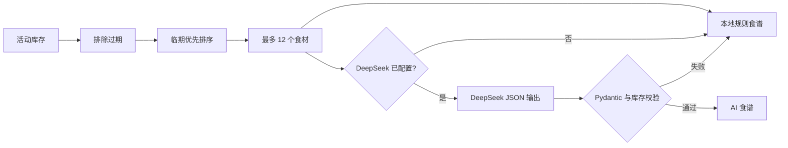
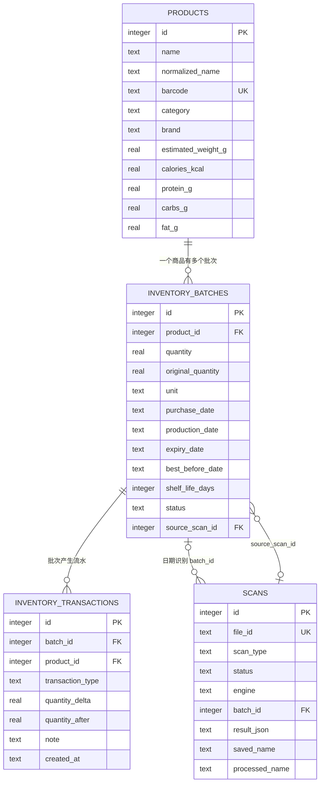

# 食光冰箱 Smart Fridge Demo — 架构与功能说明

> 版本：`0.3.0`　|　运行形态：本地优先的单体 Web 应用　|　目标设备：Windows / Linux / Orange Pi

本文面向开发、部署和后续维护人员，说明系统如何工作、每项功能由哪些文件负责，以及数据如何在前端、API、业务服务和 SQLite 之间流动。

安装与日常使用请直接查看：

- [Windows 使用文档](使用文档-Windows.md)
- [Linux / Orange Pi 使用文档](使用文档-Linux.md)

---

## 目录

1. [项目定位](#1-项目定位)
2. [总体架构](#2-总体架构)
3. [项目目录](#3-项目目录)
4. [功能与文件对应关系](#4-功能与文件对应关系)
5. [核心业务流程](#5-核心业务流程)
6. [识别子系统](#6-识别子系统)
7. [库存、营养、提醒与食谱](#7-库存营养提醒与食谱)
8. [数据架构](#8-数据架构)
9. [API 架构](#9-api-架构)
10. [前端架构](#10-前端架构)
11. [配置、文件存储与外部服务](#11-配置文件存储与外部服务)
12. [启动、部署与维护](#12-启动部署与维护)
13. [设计约束与扩展指南](#13-设计约束与扩展指南)

---

## 1. 项目定位

食光冰箱是一个运行在本机或 Orange Pi 上的食品库存 Demo。浏览器负责拍照、候选编辑和库存操作；FastAPI 负责业务编排；SQLite 和本地目录保存数据与图片。

### 1.1 当前已经实现

- 食物照片、条形码、购物小票、包装日期四种识别入口；
- YOLO ONNX 食物检测、`zxing-cpp` 条码解码、RapidOCR 中文 OCR；
- 识别候选人工确认后入库，避免模型直接污染库存；
- 商品、库存批次、库存流水和识别记录完整关联；
- 手动入库、部分使用、全部用完、丢弃和临期状态；
- 当前库存营养汇总和临期提醒；
- DeepSeek 结构化食谱，以及网络或配置异常时的本地规则降级；
- 手机优先的响应式页面和 PWA 安装能力；
- Linux / Orange Pi 安装脚本与 Systemd 自启模板。

### 1.2 设计边界

系统不追求“一张照片自动猜完并直接入库”，而是采用可审计的两阶段流程：

```text
识别阶段：图片 → 引擎分析 → 可编辑候选
确认阶段：用户核对 → 商品去重 → 创建/更新批次 → 写入库存流水
```

几个重要边界：

- 识别结果只是候选，确认前不会改变库存；
- 小票回答“买了什么”，包装日期回答“何时到期”，两次证据通过库存批次关联；
- 删除库存实际执行“丢弃”，并保留流水，不做无痕物理删除；
- 营养值是库存估算，不等于个人摄入量；
- 查看食谱不会自动扣减库存；
- 当前没有登录鉴权，只适合可信局域网，不应直接暴露到公网。

---

## 2. 总体架构

### 2.1 系统上下文



前端、后端、数据库和识别引擎都运行在同一设备上。只有主动查询条码或生成 AI 食谱时，才访问外部网络服务。

### 2.2 分层职责

| 层 | 主要职责 | 代码位置 | 不应该承担的职责 |
| --- | --- | --- | --- |
| 前端交互层 | 页面状态、拍照上传、候选编辑、结果展示 | `frontend/` | 直接操作数据库 |
| HTTP API 层 | 参数校验、状态码、工作流编排 | `app/api/` | OCR、模型推理、复杂 SQL |
| Schema 层 | 校验请求结构与字段范围 | `app/schemas/` | 持久化和业务流程 |
| 业务服务层 | 识别、解析、匹配、营养和食谱规则 | `app/services/` | HTTP 页面状态 |
| Repository 层 | SQL、事务内读写、结果序列化 | `app/database/repositories/` | 图片识别和 UI 逻辑 |
| 持久化层 | SQLite 初始化、迁移、本地文件目录 | `app/database/`、`storage/` | 业务展示 |
| 任务层 | 备份、过期检查、图片清理 | `app/tasks/` | 实时 HTTP 请求 |

### 2.3 一次请求如何穿过系统



---

## 3. 项目目录

```text
smart_fridge_demo/
├─ app/                              # Python 后端
│  ├─ api/                           # FastAPI 路由和工作流编排
│  ├─ database/
│  │  ├─ migrations/                 # SQLite 建表脚本
│  │  └─ repositories/               # 商品、库存、识别记录 SQL
│  ├─ models/                        # 轻量领域 dataclass（非 ORM）
│  ├─ schemas/                       # Pydantic 请求模型
│  ├─ services/                      # 识别、匹配、营养和食谱服务
│  ├─ tasks/                         # 备份、清理、临期检查
│  ├─ config.py                      # 路径和配置加载
│  └─ main.py                        # FastAPI 应用入口
├─ frontend/
│  ├─ index.html                     # 页面骨架
│  ├─ src/app.js                     # 前端状态与 API 交互
│  ├─ src/styles.css                 # 响应式视觉样式
│  ├─ manifest.json                  # PWA 元数据
│  └─ service-worker.js              # 静态资源缓存
├─ config/
│  ├─ api_settings.example.json      # 无密钥配置模板
│  └─ api_settings.json              # 本机真实配置，Git 忽略
├─ storage/                          # 运行时数据，不属于源码
│  ├─ database/                      # SQLite 数据库
│  ├─ uploads/                       # 上传原图
│  ├─ processed/                     # OCR 预处理图、YOLO 标注图
│  ├─ backups/                       # 数据库备份
│  ├─ logs/                          # 日志预留目录
│  └─ models/                        # 扩展模型预留目录
├─ yolo/
│  ├─ food_best.onnx                 # 食物检测模型
│  ├─ classes.txt                    # 模型类别顺序
│  └─ test food.jpg                  # 香蕉模型验收图片
├─ app.py                            # 兼容 `uvicorn app:app`
├─ receipt.jpg                       # 确定性小票 Demo
├─ requirements.txt                  # 全部运行依赖
├─ install.sh / start.sh             # Linux 安装和启动
├─ smart-fridge.service.example      # Systemd 服务模板
├─ .env.example                      # 环境变量模板
└─ 使用文档-*.md                     # Windows / Linux 操作文档
```

`__init__.py` 只负责声明 Python 包；`__pycache__/`、`.venv/` 和 pytest 缓存都是本机生成物，不应复制到 Orange Pi。

---

## 4. 功能与文件对应关系

这是定位功能代码最快的一张表。

| 业务功能 | 前端入口 | API 编排 | 核心服务 | 数据访问 / 资源 |
| --- | --- | --- | --- | --- |
| 食物照片识别 | `app.js`：`setScanType`、`analyzeSelectedFile` | `api/scans.py` | `scan_router.py` → `food_classifier.py` → `yolo_food_detector.py` | `scan_repository.py`、`yolo/`、`storage/processed/` |
| 条形码识别 | `app.js`：识别页、候选确认 | `api/scans.py`、`api/products.py` | `barcode_service.py`、`openfoodfacts_client.py` | `product_repository.py`、`scans` 表 |
| 小票识别 | `app.js`：`confirmReceipt` | `api/scans.py` | `receipt_ocr_service.py`、`product_matcher.py` | `scan_repository.py`、`inventory_repository.py`、`receipt.jpg` |
| 包装日期识别 | `app.js`：`startExpiryScan`、`confirmExpiry` | `api/scans.py` | `expiry_ocr_service.py`、`receipt_ocr_service.py` | `inventory_repository.update_expiry` |
| 手动入库 | `app.js`：`addManualInventory` | `api/inventory.py` | Pydantic Schema 校验 | `product_repository.py`、`inventory_repository.py` |
| 查看与搜索库存 | `app.js`：`filteredInventory`、`renderInventory` | `api/inventory.py` | `expiry_service.py` | `inventory_repository.list_batches` |
| 使用库存 | `app.js`：`consumeBatch` | `api/inventory.py` | — | `inventory_repository.consume` |
| 丢弃库存 | `app.js`：`askDiscard` | `api/inventory.py` | — | `inventory_repository.discard` |
| 库存流水 | 库存页面数据 | `api/inventory.py` | — | `inventory_repository.list_transactions` |
| 营养看板 | `app.js`：`renderNutrition` | `api/nutrition.py` | `nutrition_service.py` | 活动库存批次 |
| 临期提醒 | `app.js`：`renderDashboard` 根据库存直接展示；提醒 API 可独立调用 | `api/reminders.py` | `notification_service.py`、`expiry_service.py` | 活动库存批次 |
| 今日食谱 | `app.js`：`loadRecipes`、`renderRecipes` | `api/recipes.py` | `recipe_service.py`、`deepseek_client.py` | 活动库存、`config/api_settings.json` |
| 页面设置 | 暂未接入 UI | `api/settings.py` | 当前为固定默认值 | 暂未持久化 |
| 购物清单 | 暂无完整页面 | `api/shopping.py` | 下一阶段预留 | 暂无数据表 |
| 健康检查 | `app.js`：`checkHealth` | `app/main.py` | — | 返回时间和版本 |
| 数据备份与清理 | 命令行 / Systemd Timer 可扩展 | — | `tasks/backup.py`、`tasks/cleanup.py`、`tasks/expiry_check.py` | `storage/`、SQLite |

---

## 5. 核心业务流程

### 5.1 识别 → 确认 → 入库

四种识别入口共享同一个原则：先生成 `scans` 记录，再由用户确认。



确认接口与识别类型严格匹配：小票只能走 `confirm-receipt`，食物和条码走 `confirm-products`，包装日期走 `confirm-expiry`。重复确认返回 `409 Conflict`。

### 5.2 商品去重

`product_repository.get_or_create` 按以下优先级查找已有商品：

1. 有条码时，先匹配唯一条码；
2. 未匹配时，对商品名去空格、标点和短前缀后匹配 `normalized_name`；
3. 仍未找到时创建新商品。

这样同一商品的不同购买批次可以共享一条 `products` 主数据，同时分别记录数量和日期。

### 5.3 库存状态与流水



`inventory_batches.status` 保存业务状态：`active`、`used`、`discarded`。临期状态不是同一个字段，而是查询时根据日期动态计算：

| `expiry_status` | 规则 |
| --- | --- |
| `expired` | 到期日早于今天 |
| `expiring` | 今天起 0–3 天内到期 |
| `fresh` | 距到期超过 3 天 |
| `unknown` | 没有有效到期日 |

每次入库、使用和丢弃都会写入 `inventory_transactions`，保存变化量和变化后的余额。

### 5.4 包装日期二次补录

1. 前端先选择一个已有库存批次；
2. 上传包装日期图片时将 `batch_id` 一并写入识别记录；
3. OCR 提取生产日、到期日、最佳食用期和保质期；
4. 用户核对后调用 `confirm-expiry`；
5. Repository 只更新非空字段，并立即返回新的临期状态。

---

## 6. 识别子系统

### 6.1 统一分发器

`app/services/scan_router.py` 是识别入口。它持有食物、条码、小票和日期服务，根据 `scan_type` 调用对应 `recognize` 方法，使 `api/scans.py` 不需要了解具体识别引擎。

统一输出至少包括：

```text
engine          实际使用的引擎或降级方式
items/candidates 可编辑候选
processed_name  处理图文件名（如有）
raw_text         OCR 原文（如有）
```

### 6.2 四类识别能力

| 类型 | 算法和引擎 | 输出重点 | 失败兜底 | 主要文件 |
| --- | --- | --- | --- | --- |
| `food` | YOLO11 ONNX、letterbox、置信度过滤、NMS | 类别、中文名、置信度、估算数量 | 手工编辑候选 | `food_classifier.py`、`yolo_food_detector.py` |
| `barcode` | `zxing-cpp` 本地解码 | 7–14 位条码、商品候选 | 保留手动录入 | `barcode_service.py`、`openfoodfacts_client.py` |
| `receipt` | 图像增强、RapidOCR、商品行解析 | 多商品、数量、价格、购买日期 | 逐行增删改 | `receipt_ocr_service.py`、`product_matcher.py` |
| `expiry` | RapidOCR、日期正则、上下文关键字 | 生产日、到期日、最佳食用期、保质期 | 人工核对日期 | `expiry_ocr_service.py` |

### 6.3 食物照片

`yolo_food_detector.py` 完成：

1. 从 `.env` 或默认路径读取模型和类别文件；
2. 创建 ONNX Runtime CPU Session；
3. 将图片按模型输入尺寸进行 letterbox；
4. 解码 YOLO 输出，执行置信度过滤和按类别 NMS；
5. 将检测框还原到原图坐标。

`food_classifier.py` 再负责：

- 把英文类别映射为界面中文名；
- 合并同类别检测并估算数量；
- 在处理图上绘制检测框；
- 生成不依赖模型的番茄 Demo 图片。

当前 `yolo/classes.txt` 只有 `banana`。替换模型时必须同步类别顺序和 `food_classifier.py` 中的显示名映射。

### 6.4 条形码

`barcode_service.py` 使用 `zxingcpp.read_barcodes` 解码一维码和二维码，并提供可离线生成的 EAN-13 Demo。得到条码后，`api/products.py` 按“本地商品优先、Open Food Facts 次之”的顺序查询资料。

外部查询没有结果时不会阻止入库，用户仍可手动补充商品名和类别。

### 6.5 小票 OCR

`receipt_ocr_service.py` 的处理顺序：

```text
原图 → 灰度化 → 自动对比度 → 放大 → 锐化 → RapidOCR
     → 行文本清洗 → 购买日期 / 商品 / 数量 / 价格候选
```

`product_matcher.py` 进一步清洗商品名、推断分类，并为演示数据补充估算重量和营养值。

项目根目录的 `receipt.jpg` 是确定性验收样本。它使用校准结果保证低性能设备也能演示完整入库流程；其他图片不会使用这组固定商品。

### 6.6 包装日期 OCR

`expiry_ocr_service.py` 支持常见数字和中文日期格式，并依据附近语义分类：

- `生产`、`MFG`、`MFD` → 生产日期；
- `有效`、`到期`、`EXP`、`USE BY` → 到期日期；
- `最佳`、`BEST BEFORE` → 最佳食用期；
- `保质期 N 天/月/年` → 保质期天数。

当生产日期和保质期都存在但没有到期日时，服务会推算到期日。所有结果仍必须由用户确认。

---

## 7. 库存、营养、提醒与食谱

### 7.1 库存查询

`inventory_repository.list_batches` 连接商品表和批次表，默认只返回数量大于 0 的活动库存，并按“有到期日优先、到期日升序、创建时间倒序”排列。

### 7.2 营养汇总

`nutrition_service.summarize_inventory` 使用下式估算当前库存营养：

```text
批次营养 = 当前数量 × 商品估算单份重量 ÷ 100 × 每 100g 营养值
```

结果供首页能量与蛋白质、碳水、脂肪进度条展示，不作为医学或精确膳食记录。

### 7.3 临期提醒

`expiry_service.py` 汇总 `fresh / expiring / expired / unknown` 数量；`notification_service.py` 将距到期天数转成人类可读提醒。`api/reminders.py` 返回 3 天内到期和已过期批次。

### 7.4 食谱生成与降级



文件分工：

- `recipe_service.py`：库存筛选、临期排序、本地确定性食谱；
- `deepseek_client.py`：构造请求、调用 `/chat/completions`、解析 JSON；
- `RecipeDocument` / `RecipeCandidate`：校验标题、人数、耗时、食材和步骤；
- `api/recipes.py`：选择 AI 或本地结果，并返回 `generated_by` 与 `fallback_reason`。

AI 返回的食材必须能映射到当前库存，否则整次结果被拒绝并降级到本地规则。发送给 DeepSeek 的是商品文本和库存信息，不包含上传图片。

---

## 8. 数据架构

### 8.1 实体关系



### 8.2 四张核心表

| 表 | 角色 | 关键约束 |
| --- | --- | --- |
| `products` | 稳定商品主数据 | 非空条码唯一；规范化名称有索引 |
| `inventory_batches` | 可消耗的库存事实 | 必须关联商品；保留原始数量和当前数量 |
| `inventory_transactions` | 不可省略的数量变更轨迹 | 每条关联商品和批次，记录变化前因与变化后余额 |
| `scans` | 图片证据和识别结果 | `file_id` 唯一；结果以 JSON 保存；已产生库存的记录不可删除 |

### 8.3 Schema、Model 与数据库表的区别

- `app/schemas/` 是 Pydantic 请求模型，负责 API 输入校验；
- `app/models/` 是轻量 dataclass，用于表达领域概念，当前不是 ORM；
- SQLite 表结构的唯一事实来源是 `app/database/migrations/001_initial.sql`；
- Repository 当前主要返回 `dict`，不要误以为修改 dataclass 会自动改变数据库。

### 8.4 事务边界

`app/database/connection.py` 提供连接上下文。一次 API 工作流中的商品创建、批次创建、流水写入和识别确认共享同一 SQLite 连接；正常结束提交，异常时回滚。

---

## 9. API 架构

运行服务后，完整 OpenAPI 文档位于 `/docs`。

### 9.1 系统与页面

| 方法 | 路径 | 处理函数 | 用途 |
| --- | --- | --- | --- |
| `GET` | `/` | `app.main.home` | 返回前端首页 |
| `GET` | `/api/health` | `app.main.health` | 健康状态、UTC 时间、版本 |
| `GET` | `/manifest.json` | `app.main.manifest` | PWA Manifest |
| `GET` | `/service-worker.js` | `app.main.service_worker` | PWA Service Worker |

### 9.2 识别

| 方法 | 路径 | 处理函数 | 读写行为 |
| --- | --- | --- | --- |
| `POST` | `/api/scans` | `create_scan` | 保存图片、执行识别、创建待确认记录 |
| `POST` | `/api/scans/demo-receipt` | `create_demo_receipt_scan` | 使用 `receipt.jpg` 创建小票识别 |
| `POST` | `/api/scans/demo-barcode` | `create_demo_barcode_scan` | 生成并识别离线 EAN-13 Demo |
| `POST` | `/api/scans/demo-food` | `create_demo_food_scan` | 生成内置番茄 Demo |
| `GET` | `/api/scans` | `list_scans` | 查询最近识别记录，最多 100 条 |
| `GET` | `/api/scans/{scan_id}` | `get_scan` | 查询单条识别详情 |
| `POST` | `/api/scans/{scan_id}/confirm-receipt` | `confirm_receipt` | 批量创建商品、批次和入库流水 |
| `POST` | `/api/scans/{scan_id}/confirm-products` | `confirm_products` | 确认食物或条码候选并入库 |
| `POST` | `/api/scans/{scan_id}/confirm-expiry` | `confirm_expiry` | 更新指定批次日期 |
| `DELETE` | `/api/scans/{scan_id}` | `delete_scan` | 删除未形成库存引用的识别和图片 |

### 9.3 商品与库存

| 方法 | 路径 | 处理函数 | 用途 |
| --- | --- | --- | --- |
| `GET` | `/api/products` | `list_products` | 按名称或条码搜索商品 |
| `POST` | `/api/products` | `create_product` | 去重后创建商品 |
| `GET` | `/api/products/barcode/{barcode}` | `lookup_barcode` | 本地优先，再查询 Open Food Facts |
| `GET` | `/api/inventory` | `list_inventory` | 活动库存、数量和临期汇总 |
| `POST` | `/api/inventory` | `create_manual_inventory` | 手动创建商品和库存批次 |
| `GET` | `/api/inventory/transactions` | `list_transactions` | 查询最近库存流水 |
| `POST` | `/api/inventory/{batch_id}/consume` | `consume_inventory` | 部分或全部使用库存 |
| `DELETE` | `/api/inventory/{batch_id}` | `discard_inventory` | 丢弃剩余库存并写流水 |

### 9.4 看板与预留接口

| 方法 | 路径 | 处理函数 | 用途 |
| --- | --- | --- | --- |
| `GET` | `/api/nutrition/summary` | `nutrition_summary` | 汇总当前库存营养 |
| `GET` | `/api/reminders` | `reminders` | 返回临期提醒文案 |
| `GET` | `/api/recipes/today` | `today_recipe` | AI 或本地今日食谱 |
| `GET` | `/api/settings` | `settings` | 当前返回固定默认设置 |
| `GET` | `/api/shopping` | `shopping_list` | 下一阶段购物清单占位接口 |

### 9.5 输入保护

`api/scans.py` 在进入识别引擎前统一限制：

- 只接受 JPG、PNG、WEBP；
- 默认最大 15 MB，可通过环境变量调整；
- 上传内容必须能被 Pillow 验证为有效图片；
- `scan_type` 只能是 `food / barcode / receipt / expiry`；
- 日期确认统一要求 `YYYY-MM-DD`；
- 包装日期识别必须关联存在的库存批次。

---

## 10. 前端架构

前端没有构建步骤，也没有第三方框架。FastAPI 直接返回 `frontend/index.html`，并把 `frontend/src/` 挂载为 `/static`。

### 10.1 四个主视图

| 视图 | HTML 容器 | 主要渲染函数 | 数据来源 |
| --- | --- | --- | --- |
| 今天 | `#view-home` | `renderDashboard`、`renderNutrition`、`renderRecipeSummary` | 库存、营养、食谱、识别历史 |
| 库存 | `#view-inventory` | `renderInventory`、`filteredInventory` | `/api/inventory` |
| 识别 | `#view-scan` | `setScanType`、`renderScanResult`、`renderScanHistory` | `/api/scans` |
| 食谱 | `#view-recipes` | `loadRecipes`、`renderRecipes` | `/api/recipes/today` |

### 10.2 `frontend/src/app.js` 的职责分组

| 分组 | 主要函数 |
| --- | --- |
| 全局状态与请求 | `state`、`api`、`loadAll`、`refreshInventoryData` |
| 导航与反馈 | `navigate`、`showLoading`、`hideLoading`、`toast` |
| 首页 | `renderDashboard`、`renderNutrition`、`renderRecipeSummary` |
| 库存 | `filteredInventory`、`renderInventory`、`addManualInventory`、`consumeBatch`、`askDiscard` |
| 识别 | `setScanType`、`analyzeSelectedFile`、`useDemoScan`、`renderScanResult` |
| 候选确认 | `candidateRow`、`collectCandidateItems`、`confirmReceipt`、`confirmProducts`、`confirmExpiry` |
| 识别历史 | `renderScanHistory`、`openScan`、`refreshScans` |
| 日期补录 | `populateBatchSelect`、`startExpiryScan` |
| 食谱和健康 | `loadRecipes`、`renderRecipes`、`checkHealth` |

### 10.3 PWA

- `manifest.json` 定义应用名称、图标主题和启动方式；
- `service-worker.js` 缓存页面骨架与静态资源；
- API 和用户图片仍以网络优先方式从本机服务读取；
- 修改前端后若仍看到旧页面，应强制刷新或清理站点缓存。

---

## 11. 配置、文件存储与外部服务

### 11.1 配置来源与优先级

```text
环境变量 / .env
        ↓ 覆盖
config/api_settings.json
        ↓ 缺省
代码默认值
```

| 文件 | 用途 | 是否可提交 |
| --- | --- | --- |
| `.env.example` | 存储路径、上传大小、YOLO 参数、部署 API 覆盖模板 | 可以 |
| `.env` | 当前设备真实环境变量 | 不可以，Git 忽略 |
| `config/api_settings.example.json` | DeepSeek / Open Food Facts 无密钥模板 | 可以 |
| `config/api_settings.json` | 桌面用户可视化配置和真实密钥 | 不可以，Git 忽略 |
| `app/config.py` | 加载路径、建立目录、读取 JSON | 源码 |

常用环境变量：

| 变量 | 默认值 / 作用 |
| --- | --- |
| `SMART_FRIDGE_STORAGE_DIR` | 默认项目内 `storage/` |
| `SMART_FRIDGE_DB_PATH` | 默认 `storage/database/smart_fridge.db` |
| `SMART_FRIDGE_MAX_UPLOAD_MB` | 默认 `15` |
| `SMART_FRIDGE_YOLO_MODEL` | 覆盖 ONNX 模型路径 |
| `SMART_FRIDGE_YOLO_CLASSES` | 覆盖类别文件路径 |
| `SMART_FRIDGE_YOLO_CONFIDENCE` | 默认 `0.25` |
| `SMART_FRIDGE_YOLO_IOU` | 默认 `0.45` |
| `DEEPSEEK_API_KEY` | 覆盖 JSON 中的密钥 |
| `DEEPSEEK_BASE_URL` | DeepSeek 兼容接口地址 |
| `DEEPSEEK_MODEL` | 默认项目模型名 |
| `DEEPSEEK_TIMEOUT_SECONDS` | 请求超时 |

### 11.2 本地文件生命周期

| 路径 | 创建者 | 删除 / 保留规则 |
| --- | --- | --- |
| `storage/uploads/` | `api/scans.py` | 保存原图；删除未引用识别时同步删除 |
| `storage/processed/` | OCR、食物和条码服务 | 可由清理任务删除过期处理文件 |
| `storage/database/smart_fridge.db` | `database/connection.py` | 核心业务数据，必须备份 |
| `storage/backups/` | `tasks/backup.py` | 时间戳数据库副本 |
| `yolo/food_best.onnx` | 随项目分发 | 模型资产，不属于上传数据 |

### 11.3 外部服务

| 服务 | 触发条件 | 发送内容 | 失败策略 |
| --- | --- | --- | --- |
| Open Food Facts | 本地没有对应条码时主动查询 | 条码 | 返回未找到，允许人工补录 |
| DeepSeek | 已配置 API Key 且请求今日食谱 | 商品名、分类、数量、单位、临期信息 | 立即降级本地规则 |

上传图片、SQLite 库存和用户操作不会自动同步到云端。

---

## 12. 启动、部署与维护

### 12.1 应用启动顺序


### 12.2 启动相关文件

| 文件 | 职责 |
| --- | --- |
| `app/main.py` | 创建 FastAPI、注册路由、初始化数据库、挂载静态目录 |
| `app.py` | 兼容旧命令 `uvicorn app:app` |
| `requirements.txt` | FastAPI、图像、ONNX、条码、OCR 的统一依赖 |
| `install.sh` | apt 系统依赖、Linux `.venv`、pip 依赖和数据目录 |
| `start.sh` | 校验 Linux 虚拟环境和端口，启动 Uvicorn |
| `smart-fridge.service.example` | Systemd 常驻与故障重启模板 |

Windows 与 Linux 虚拟环境结构不同，`.venv` 必须在目标设备重新创建。

### 12.3 维护任务

| 命令模块 | 功能 | 主要文件 |
| --- | --- | --- |
| `python -m app.tasks.expiry_check` | 生成当前临期提醒文本 | `tasks/expiry_check.py`、`notification_service.py` |
| `python -m app.tasks.backup` | 创建数据库时间戳备份 | `tasks/backup.py` |
| `python -m app.tasks.cleanup` | 清理超过保留天数的处理图 | `tasks/cleanup.py` |

这些任务目前是独立命令，可进一步接入 Systemd Timer 或 cron。

### 12.4 最小备份范围

必须备份：

```text
storage/database/smart_fridge.db
```

如需保留识别证据，再同时备份：

```text
storage/uploads/
storage/processed/
```

---

## 13. 设计约束与扩展指南

### 13.1 当前约束

- 当前 YOLO 模型只有 `banana` 类别；内置番茄图片是独立的规则 Demo；
- `api/settings.py` 返回固定值，尚未保存用户偏好；
- `api/shopping.py` 是购物清单预留接口；
- `app/models/` 不是 ORM，数据库仍由 SQL Migration 和 Repository 管理；
- 食谱只负责推荐，不会自动扣减库存；
- 项目当前没有账户、权限、HTTPS 和公网安全边界；
- 当前工作区已移除自动化测试目录，修改核心流程后应至少完成手工回归。

### 13.2 增加新的识别类型

推荐按以下顺序改动：

1. 在 `app/services/` 新建具有 `recognize` 方法的服务；
2. 在 `scan_router.py` 注册新类型；
3. 在 `api/scans.py` 的允许类型中加入新值；
4. 在 `frontend/src/app.js` 的识别配置中增加标签、提示和确认逻辑；
5. 如果结果会入库，复用商品、批次和流水 Repository；
6. 更新本文的识别表和 API 表。

### 13.3 替换模型或 OCR 引擎

优先保持服务层输出结构不变。只要继续返回统一候选，API、前端确认和库存数据结构就无需重写。

替换 YOLO 模型时需要同步：

- `yolo/food_best.onnx`；
- `yolo/classes.txt`；
- `food_classifier.py` 的中文显示映射；
- `.env` 中的模型路径和阈值（如有覆盖）。

### 13.4 推荐的后续工作

1. 在目标 Orange Pi 上记录 YOLO、RapidOCR 的耗时和内存；
2. 恢复自动化回归测试，优先覆盖“识别 → 确认 → 入库 → 流水”；
3. 增加商品别名和纠错回写，提高小票匹配率；
4. 将设置与用户偏好持久化；
5. 为 DeepSeek 增加结果缓存、限流和费用上限；
6. 实现“确认烹饪 → 按配方事务扣减多个批次”；
7. 若需要公网访问，增加认证、HTTPS、反向代理和上传速率限制。

---

## 文件定位速查

```text
改接口             → app/api/
改请求字段校验     → app/schemas/
改识别或业务规则   → app/services/
改 SQL 与库存行为  → app/database/repositories/
改数据表           → app/database/migrations/
改页面结构         → frontend/index.html
改页面交互         → frontend/src/app.js
改视觉样式         → frontend/src/styles.css
改本机路径和配置   → app/config.py、.env、config/api_settings.json
改部署方式         → install.sh、start.sh、smart-fridge.service.example
```
