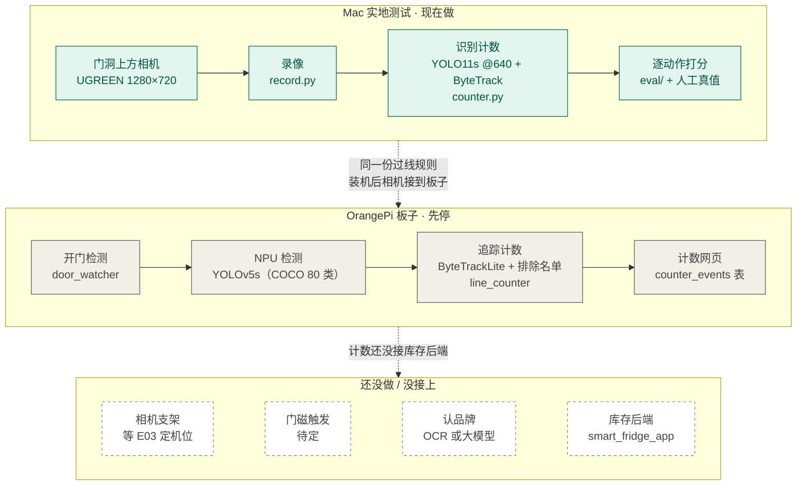
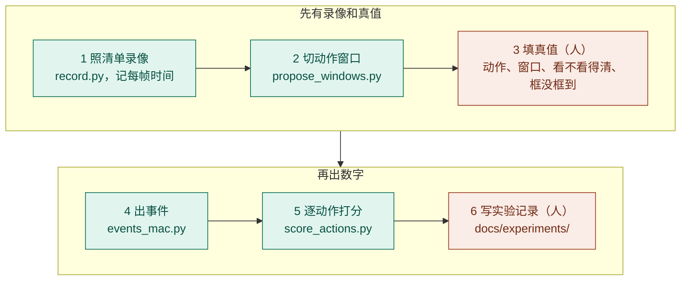

# 技术方案简图（2026-11-21）

按 11-21 仓库里的代码和文档画的"现在实际是什么样"。和 [ARCHITECTURE.md](ARCHITECTURE.md) §2 的图不同：那张是"关门后离线分析 + 大模型认名"的对照路线，现在走的是实时过线计数。

> **11-25 更新**：这张图画的是 11-21 的情况。11-24 识别的主线换成了"关门后由视觉模型看手里东西的前后状态"（[决策日志](DECISIONS.md)），11-25 项目收尾。
> 图没有照新方案重画：新方案里只有"判断"这一步写成了程序（`fridge_vision/judge_door.py`），它没有接进图里的任何一块；板子上跑的仍然是过线计数。

图用 Mermaid 写，在 GitHub 网页上直接显示成图。

## 1. 总览：三块

绿色 = 现在在做；灰色 = 做好了，先停；虚线框 = 还没做或没接上。

## 2. Mac 实地测试：从录像到打分

绿色 = 程序跑；橙色 = 人来做。每一步的命令见 [eval/README.md](../eval/README.md)。

## 读图时要知道的

- **Mac 上的数字不等于板子的数字。** 两边只有过线规则是同一份（`demos/yolo_web_counter/counter.py` 和 `orangepi_app/app/services/line_counter.py`，11-21 比过，内容一致）。检测器不同（YOLO11s 对 NPU YOLOv5s），追踪器不同（ultralytics ByteTrack 对 `ByteTrackLite`），而且 Mac 路线假设开门检测是完美的。部署版本的数字只能在板子上用 `--engine npu` 得到。
- **板子那一行按仓库里的 `orangepi_app/` 画**，板子上的事实截至 11-08。
- **E03 还没录**（见 [E03 记录](experiments/E03_position_20261112.md)）；实地测试从第 2 张图的第 1 步开始。
- **打分表要带 95% 区间，需要 `eval/wilson.py`**（由项目发起人写）；没有它照样出表，只是没有区间。
- **图里没有放准确率数字**：已有数字的口径见 [CLAIMS_CHECK](experiments/CLAIMS_CHECK.md)。
