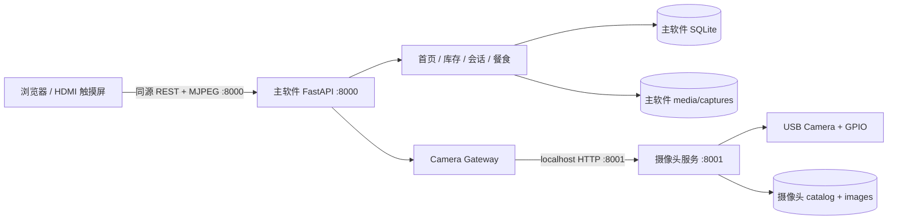
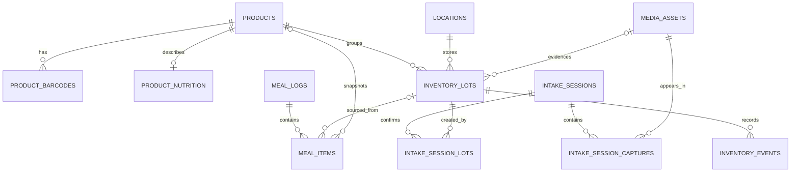
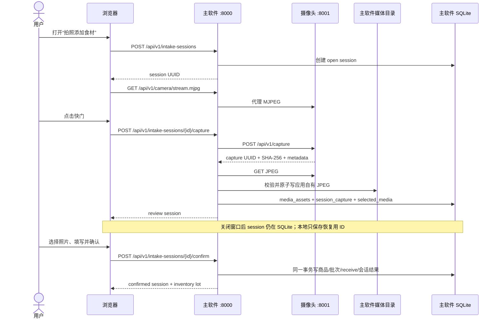

# 主软件架构与稳定边界

## 1. 两个进程、两个端口

摄像头是有状态、独占、容易断连的硬件；库存 API 是可重试、短生命周期的业务请求。
把二者放进同一个 Web worker，会导致热重载、多 worker、OCR 崩溃或主应用重启时反复
抢占 `/dev/video*`。当前实现因此采用两个本地进程：



稳定规则：

- 主应用监听 `0.0.0.0:8000`，是可信局域网内唯一面向浏览器的入口；
- 摄像头集成服务监听 `127.0.0.1:8001`，浏览器不直接访问；
- 主软件不直读摄像头 SQLite 或图片路径，只调用其 HTTP API；
- capture UUID、SHA-256、拍摄时间和版本化 API 是进程间契约；
- 摄像头是设备的唯一所有者，主软件和浏览器不直接打开 `/dev/video*`；
- 摄像头离线只让实时预览和新拍摄降级，已导入图库和库存仍可使用；
- 主软件固定单 worker，避免 SQLite 进程内锁和运行期状态被多个 worker 分裂。

## 2. 代码分层

| 层 | 职责 | 位置 |
| --- | --- | --- |
| 前端 | 首页动态显隐、原生 `<dialog>`、会话恢复、预览、图库、人工确认 | `frontend/` |
| HTTP API | 参数校验、状态码、业务编排、同源相机 facade | `app/api/` |
| Camera Gateway | 8001 超时、错误归一、响应脱敏和 MJPEG 代理 | `app/services/camera_gateway.py` |
| Capture Library | 下载/校验/导入图片，把媒体绑定到录入会话 | `app/services/capture_library.py` |
| Media Store | 应用自有 JPEG 的原子写入、读取、隔离和路径约束 | `app/services/media_store.py` |
| Repository | 商品、批次、流水、会话、媒体、餐食、首页聚合与设置 | `app/repositories/` |
| 数据库 | 连接、迁移、日志模式、事务和在线备份 | `app/database/` |
| 运维任务 | 数据库+引用媒体备份包；后续增加恢复、对账和清理 | `app/tasks/` |

FastAPI 负责接口与校验，核心库存、会话和统计逻辑仍可不启动 Web 服务器直接用
`unittest` 验证。

## 3. 数据与所有权



- `products` 是稳定商品身份；条码、主要口味和可选营养基准属于商品；
- `inventory_lots` 是实际批次，同一种食物不同到期日不能合并；
- `inventory_events` 是数量账本，入库、吃掉和丢弃都保留发生后的数量；
- `media_assets` 保存应用自有 JPEG 的相对路径、SHA-256 和摄像头元数据；图片不放入
  SQLite BLOB；
- `intake_sessions` 保存 `open → review → confirmed/cancelled` 生命周期、所选照片和确认结果；
- 会话与照片、会话与批次通过显式关联表连接，避免只靠浏览器临时状态；
- `meal_logs`/`meal_items` 是真实摄入账本，保存食用时间以及当时的名称、类别、口味和
  可计算营养快照；后续修改商品资料不会改写过去餐食；
- `version` 与 `expected_version` 用于拒绝旧页面对库存批次的并发覆盖。

单位只做确定性换算：完全相同单位、g↔kg、ml↔l。系统尚无商品级“一盒/一个对应多少
克”的换算，因此不能用猜测填补营养统计。

## 4. 应用自有图片库

摄像头服务保存的是采集侧记录；主软件不会把跨进程路径当成自己的长期证据。导入过程是：

1. 从 8001 取得 capture record 与 JPEG；
2. 验证 ID、MIME、JPEG 首尾、25 MB 上限和 SHA-256；
3. 按 `media/captures/YYYY/MM/DD/<capture-id>.jpg` 生成应用内路径；
4. 写入同目录 `.jpg.part`，`flush + fsync` 后 `os.replace` 原子改名；
5. 在主数据库写 `media_assets`；若数据库写失败，新文件移入 `media/quarantine/`；
6. 同一 capture ID 已存在时校验内容一致，不以不同字节覆盖。

导入后的图库和库存图片从主软件媒体目录读取，因此 8001 离线时仍可查看。摄像头侧
catalog/images 仍有独立价值：GPIO 拍摄可能尚未导入主软件；进入“识别记录”时当前前端会
同步最近 24 条摄像头记录，再从主应用图库展示。

默认开发路径和示例生产路径：

| 所有者 | 开发 | 示例生产 |
| --- | --- | --- |
| 主数据库 | `runtime/database/smart_fridge.sqlite3` | `/var/lib/smart-fridge/database/smart_fridge.sqlite3` |
| 主应用图片 | `runtime/media/captures/` | `/var/lib/smart-fridge/media/captures/` |
| 摄像头 catalog | `../camera_system/data/capture_catalog.sqlite3` | `/var/lib/camera-capture/catalog.sqlite3` |
| 摄像头图片 | `../camera_system/captures/` | `/var/lib/camera-capture/images/` |

## 5. 持久化拍照录入流程



持久性与幂等边界：

- 浏览器 `localStorage` 只保存最后一个会话 ID；真正状态在 SQLite，服务重启后仍可恢复；
- 首页 API 也会把最新 `open/review` 会话放入“继续刚才的拍照录入”；
- `×` 关闭对话框不取消会话，停止预览并将焦点还给打开按钮；
- “放弃本次”才标记 `cancelled`，不会删除已保存照片；
- `confirmed` 会话不能取消或再接照片；重复确认返回已关联批次而不再次写 `receive`；
- 当前只持久化会话、照片、选择和确认结果；尚未把未提交表单字段写入 `draft_json`。

视觉/OCR 后续只能插在“媒体已安全保存”和“用户确认”之间，并输出可编辑候选。模型失败、
低置信度或替换 provider 都不得损坏原图、会话或库存账本。

## 6. 首页显隐与真实摄入

首页不把 `0`、加载失败和“尚未记录”混为一谈。Repository 返回显式 `availability`，前端
据此决定是否渲染：

- 正常的系统/摄像头状态隐藏，只有异常状态显示；
- 无库存且无拍摄/待办时显示一个“拍下第一件食材”的激活空状态；
- 库存概览仅在有活动批次时出现；过期、临期和日期待补卡只在数量大于 0 时出现；
- “优先处理”、规则食谱、最近拍摄和待续会话只在确有内容时出现；
- 营养和口味都没有真实样本时，整个摄入区隐藏；
- 有一条带营养的餐食可以显示已记录合计，但每日趋势图至少需要两个有营养记录的日期；
- 有口味样本可以显示“口味记录”，累计至少 3 次后才称为“口味趋势”。

库存流水与餐食流水是两个概念。`POST /inventory/{lot}/consume` 总会减少库存并写
`inventory_events`；只有 `record_meal=true` 时才同时写 `meal_logs` 和 `meal_items`。API
默认值是 `false`，防止未来自动盘点、纠错或普通库存调整污染摄入趋势；当前网页“吃掉”
按钮明确传 `true`，丢弃永远不产生餐食。`/api/v1/insights` 只读餐食表，不从库存减少量
反推用户已经吃下。

## 7. 一致性与备份边界

- 每次写操作使用短连接与 `BEGIN IMMEDIATE`；进程内写操作由一把锁串行化；
- 每条连接开启 `foreign_keys` 和 `busy_timeout`；
- 会话确认、批次创建、`receive` 流水和会话结果在同一事务；
- 吃掉操作、库存负向流水和可选餐食快照在同一事务；
- 使用/丢弃通过 `expected_version` 做乐观并发检查；
- 删除不是 MVP 库存操作，丢弃保留负向流水；
- 未确认 SQLite 带 WAL-reset 修复时不启用 WAL；
- 备份先用 `Connection.backup()` 和 `integrity_check` 生成一致性数据库快照，再按快照引用
  收集主应用正式图片。

现有命令：

```bash
PYTHONPATH=. python3 -m app.tasks.backup --output-dir backups
```

它在临时目录中创建以下主应用恢复集，全部成功后才用原子改名发布：

```text
smart_fridge_YYYYMMDD_HHMMSS/
├── smart_fridge.sqlite3
├── manifest.json
└── media/captures/...
```

媒体清单严格来自一致性数据库快照中 `state='ready'` 且有 `local_relpath` 的记录。复制前
验证源文件存在、路径不逃逸且 SHA-256/大小匹配，复制后再次验 SHA；manifest 同时记录
数据库和每张图片的字节数与 SHA-256。由此：

```text
主应用可恢复集 = 单个备份目录包
整台设备可恢复集 = 主应用目录包 + 摄像头 catalog + 摄像头 images/
```

quarantine、未入库孤儿和数据库快照后产生的新照片不会混入该包，这保证内部一致性；
摄像头目录仍可能有尚未同步的 GPIO 拍摄。自动恢复验证以及协调 camera_system 的整机备份
仍是 Phase 1 缺口。

## 8. 当前不做与已知限制

- AI 自动修改库存，或根据过敏/用药信息宣称食物绝对安全；
- 多设备离线写入、用户权限和冲突合并；
- 连续录像、云端直播、WebRTC/HLS；
- 把图片作为 SQLite BLOB，或合并主软件和摄像头数据库；
- 会话表单字段自动保存、多食材候选、相册上传、条码和语音入口；
- 餐食编辑/撤销、多食材合并为一餐以及完整营养数据库；
- 图片启动对账、缩略图、配额、保留期、软删除、自动恢复验证和整机协调备份；
- 公网认证、TLS 和速率限制。

这些边界不是永久限制，而是先隔离硬件可靠性、图片持久性、识别准确率和库存正确性，
让后续能力可以逐层替换和验收。
